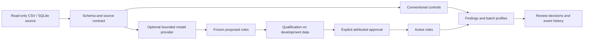

# Architecture and enforcement

`dqpilot` is a local Python service/library with a CLI, not a production web application. CSV adapters and a read-only SQLite connector produce dataframes. Source contracts are attributed YAML. A nine-kind declarative rule language compiles to parameterized SQLite SELECT statements; arbitrary model SQL/Python is rejected. The source data and the writable governance database are separate.

Acquisition verifies pinned SHA-256 archives and members, including nested UCI ZIPs; existing mismatching files abort. Raw data have no write permission bits. This protects against routine accidental writes, not the machine owner deliberately changing permissions. Git versions and source hashes are retained; paid-call/cache files and source values remain ignored.

The engine executes only compiler-generated queries. It quotes schema identifiers and binds values. SQLite `query_only`, an authorizer restricting tables/functions/operations, and progress-handler deadlines are enforced. The external SQLite connection uses `mode=ro`. DDL, writes, extension loading and model-provided SQL have no supported route. Tests exercise malicious identifiers/values and attempted prohibited operations. This is a bounded local execution design, not an audited container sandbox for arbitrary code.

Qualification checks representation syntax, schema, reversed ranges, duplicate signatures, execution, whitespace invariance, source-evidence presence and a fixed 1% development alert-fraction screen. A string citing evidence is not verified semantic truth; broad logical contradiction/subsumption proving is not implemented. High alert rates may mean a useful rule sees genuine errors: they trigger review rather than being called false positives. The same candidate objects feed raw C and qualified D evaluation. Static safety applies in both; qualification receives no evaluation labels.

Service states are PROPOSED, VALIDATED, APPROVED, ACTIVE, REJECTED, NEEDS_REVIEW and DISABLED. Validation does not approve/activate. The API records attributed actor, timestamp, reason and transitions. Only ACTIVE source-matching rules create operational findings. Findings retain source batch, row, column, rule, value, evidence and review disposition. Profiles retain missingness, distinct count and numeric means; these support descriptive delivery monitoring, not an automatically calibrated concept-drift diagnosis.

Actor strings and database access are **simulated governance**, not authentication, RBAC, separation of duties or tamper-evident audit. The machine owner can edit the database. A bank deployment needs authenticated reviewers, source-specific access controls, retention/redaction, durable approval evidence and independent semantic review. No private or Kaggle data was sent to a model.

The provider accepts only explicitly classified unrestricted public context, supports separate generation/detection prompts, requires explicit authorization plus enabled configured model/prices/budgets, reserves calls/spend atomically before HTTP, and caches by endpoint/model/prompt/input/parameters. Failed/in-flight calls are not automatically billed twice on resume. Credentials are read from environment only and not included in logs. API results preserve model identity, usage and local price-based cost calculation. Hard local caps rely on reviewed provider pricing/token accounting; this is not an upstream account-wide billing cap. Provider tests mock HTTP and are not experimental LLM inference.
