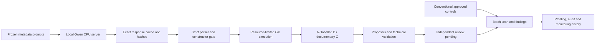

# Connected engineering artifact

The artifact extends the preserved provider/cache/GX pipeline and the existing SQLite control service. Actual model proposals enter its lifecycle; hand-authored fixtures and published predictions never substitute for generated candidates. A safe native mapping supports existing service rule types while the research evaluator retains a broader literal GX subset.

The completed journal demonstration imports **6 actual generated native proposals**, records **54 audit events** and **8 monitoring records**. Model state counts: `{'NEEDS_REVIEW': 1, 'REJECTED': 3, 'VALIDATED': 2}`. **0 generated rules are ACTIVE; independent human approvals: 0.** Existing self-authored conventional contract controls alone are approved/activated by an explicitly named controlled operator. No artificial reviewer is invented. Clean and changed-batch scans, findings and state counts are saved in `results/execution/service_demo.json`.

The scenario states a per-journal, same-currency integer-cent debit/credit equality. It does not sum arbitrary positive debit/credit columns to zero or assume all financial statement totals balance universally. The inherited SEC adapter separately handles explicit coordinates, signed coefficients, units and rounding; its analyst development proposals remain pending and reserved bases untouched.

The counts above describe the initial demo. An additional executed engineering correction (`service_schema_guard_supplement.json`) adds explicit numeric guards for both amount fields. The principal journal baseline lacked them and skipped nonnumeric values in range/equality checks, detecting only eight currency-code changes. With these two ordinary schema guards the service flags 24/24 stipulated invalid rows, with no off-scenario labelled rows and no active model rule. This was added after inspecting exploratory outcomes, is labelled post hoc, and does not replace any primary A/B/C/D result or establish a research improvement. Run `service_demo.py` then `service_schema_guard_demo.py` to recreate the two stages on a fresh ignored service database.

Technical code execution is confined to allowed literal GX constructors and class-specific primitive keyword arguments. Imports, dynamic calls, row conditions, arbitrary SQL and query constructors are rejected before the unchanged upstream evaluator is reached. CPU/address-space/wall ceilings limit the worker; regex length and payload size are bounded. This is a constrained local research threat model, not a hardened multi-tenant sandbox.

The model endpoint is authenticated and loopback-only. Requests are content-addressed by pinned model/runtime/prompt/settings, successful results reused and incomplete attempts retained. Secrets, raw datasets, weights and databases remain ignored. Exact new metadata-only responses and prompts are exported for analysis reproduction. No paid endpoint or public server is started.

Limitations: actor names are attribution strings rather than enterprise identity; SQLite logs are not tamper-proof authorization; automated documentary certificates are not independent human approval; the adapter cannot represent every GX expression; no private Avanade/Rabobank integration or production deployment occurred. The artifact demonstrates a connected workflow and preserves review gates. Its usefulness does not establish a novel AI algorithm.

The native engine normalizes numeric/code strings, which can differ from exact GX membership on changed representations. The demo therefore records the original GX expression and the mapped native proposal together, and activates none of them. Research detection scores come from the actual GX evaluator; service mappings are not silently substituted into those results.
