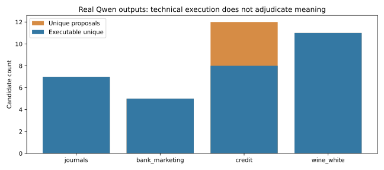

# Actual generated candidates and technical evaluation

**56 real requests; 211 emitted raw rule objects; 183 parser-admitted occurrences; 62 unique source/condition candidates; 47 executable unique candidates.** Uniqueness is normalized AST constructor syntax (keyword order ignored), not proof of distinct semantics. Duplicate rules across sources/conditions remain separate experimental items.

| Condition | Source | Calls | Parsed | Rule occurrences | Unique | Executable unique |
| --- | --- | --- | --- | --- | --- | --- |
| benchmark | raha_beers | 2 | 2 | 8 | 8 | 8 |
| benchmark | raha_hospital | 2 | 2 | 8 | 8 | 8 |
| guided | synthetic_balanced_journals | 12 | 12 | 45 | 7 | 7 |
| guided | uci_bank_marketing | 12 | 9 | 27 | 5 | 5 |
| guided | uci_credit | 12 | 9 | 36 | 12 | 8 |
| guided | uci_wine_white | 12 | 12 | 48 | 11 | 11 |
| original | synthetic_balanced_journals | 1 | 1 | 4 | 4 | 0 |
| original | uci_bank_marketing | 1 | 0 | 0 | 0 | 0 |
| original | uci_credit | 1 | 1 | 4 | 4 | 0 |
| original | uci_wine_white | 1 | 1 | 3 | 3 | 0 |

`tables/generation_yield.csv` includes duplicate and executable-occurrence counts. `tables/prompt_strata.csv` separates documentation, instruction variant and seed-response diversity. `response_parsing_diagnostics.json` distinguishes emitted objects from accepted bundles. The parser is strict and rejects the entire bundle for duplicate IDs; its saved `MALFORMED_OR_TRUNCATED` label includes such schema failures even when finish reason is STOP and JSON is valid. The diagnostic names the actual observed reason; no missing token usage or truncation is invented.

## Inspectable failures and proposals

The original Wine smoke returned GX class references without complete constructor calls; Credit and journals used obsolete/unsupported methods. All 11 admitted original proposals fail the technical gate; the original Bank bundle emitted four rule objects but failed duplicate-ID validation. All seven rejected bundles across conditions have this duplicate-ID cause, not actual output truncation. The separate generic syntax appendix was frozen from technical smoke evidence before any new held-out detection score. The 48 adapted prompts were then retained regardless of Hospital/Beers results. Generic example bounds 0..10 may influence content, so this is not a clean causal syntax-only ablation.

A real journal proposal describes debits equalling credits but calls `ExpectMulticolumnSumToEqual` on both positive columns with `sum_total=0`. It can execute, yet its expression differs from the intended equality. This is an inspectable scenario-contract disagreement, not a fabricated independent semantic-review verdict. Other actual proposals implement direct pair equality correctly under the stipulated scenario. Both remain in the frozen set.

A Beers proposal constrains `abv` to 3..15 and `ounces` to 0.5..12, supplying generated web citations. Those citations are unverified model text; source units and packaging exceptions are not established by a plausible URL. Hospital includes an executing phone pattern that flags every development row. Large violation counts alone cannot determine whether the rule, representation or source is wrong. These outputs demonstrate why execution and meaning need separate evaluation.

Unsupported constructors, unknown columns, nonliteral/dynamic arguments and forbidden keywords are technical exclusions. Supported constructors can still fail GX execution, especially on mixed-type stress data; held-out execution results are preserved separately from the development gate. Failure to express a valid relation in the allowed subset is not evidence that the relation is semantically invalid. No unrestricted generated Python/SQL is executed. No hand-authored candidate replaces a model failure.

The exact model text is in `raw_model_responses/`; accepted candidate files preserve original descriptions, references and request provenance. Pending reviewer packets contain real frozen candidates and blank judgments. Independent semantic precision, invalid-promotion rate and inter-rater agreement are **NOT MEASURED**.
