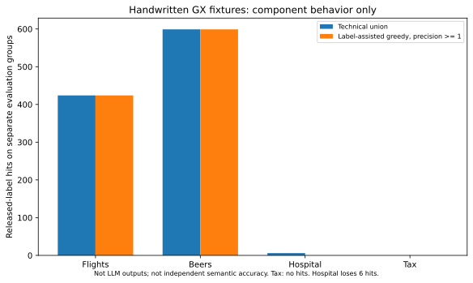

# Final feasibility phase

The verdict is **CONDITIONAL GO for a bounded continuation**, with no claim that the core generated-rule experiment is complete. Start with [decision](final_go_no_go.md), [supervisor proposal](thesis_proposal.md), and [model recommendation/costs](model_access_and_costs.md).

Required reports:

1. [Closest work](closest_work_review.md)
2. [LeDQeR component reproduction](ledqer_reproduction.md)
3. [Dataset qualification](dataset_final_qualification.md)
4. [Financial rules](financial_rules_evaluation.md)
5. [Candidate experiments and unrun core](candidate_rule_experiments.md)
6. [Novelty assessment](research_novelty_assessment.md)
7. [Research design](thesis_research_design.md)
8. [Supervisor proposal](thesis_proposal.md)
9. [Both pilots compared](pilot1_pilot2_final_comparison.md)
10. [Final decision](final_go_no_go.md)

The parent pilot's reports/results remain historical and unchanged. New results live in `results/final/`; raw sources, prompt samples and local logs remain ignored. Source references, locked dependencies, executable helpers and tests are included. No new paid model call was made.

```bash
export UV_CACHE_DIR=/workspace/.cache/uv
uv sync --project envs/final --frozen
PYTHONPATH=src .venv/bin/python scripts/final/restore_parent_inputs.py
PYTHONPATH=src envs/final/.venv/bin/python scripts/final/acquire.py
PYTHONPATH=src envs/final/.venv/bin/python scripts/final/acquire_finrule.py
PYTHONPATH=src envs/final/.venv/bin/python scripts/final/acquire_literature.py
MPLCONFIGDIR=/tmp/dq-final-mpl PYTHONPATH=src envs/final/.venv/bin/python scripts/final/run.py
MPLCONFIGDIR=/tmp/dq-final-mpl PYTHONPATH=src envs/final/.venv/bin/pytest -q tests_final
envs/final/.venv/bin/ruff check src/dqpilot_final scripts/final tests_final
.venv/bin/dqp verify
PYTHONPATH=src envs/final/.venv/bin/python scripts/final/verify.py
```

`run.py` reuses completed results instead of overwriting them; it makes no inference request. A completed missing-credential Kaggle result remains a historical attempt. After a new secret becomes available, explicitly rerun the acquisition helper with the old attempt preserved in a separate output/version before updating claims. Public-source hashes protect against replacing changed snapshots.


