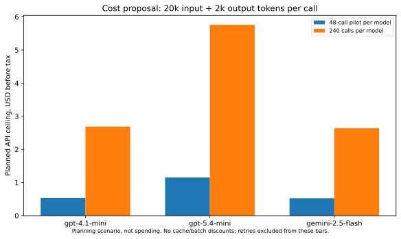

# Research-model recommendation and cost proposal

**Recommendation:** begin with **OpenAI GPT-4.1 mini**, preferably the dated `gpt-4.1-mini-2025-04-14` revision after access verification. Use a 48-call micro-pilot, a local maximum of 60 total attempts and a proposed **US$2 spending cap**. Add **GPT-5.4 mini** as a stronger coding comparator only if the micro-pilot and independent-review plan justify it. The full two-model proposal has a **US$15 cap**. No provider/model has been approved and no model call has run.

This choice prioritizes affordable structured/code output, bounded non-reasoning token accounting, a dated model where available and a manageable request contract. It is not a measured claim that GPT-4.1 mini has the best DQ-rule accuracy. Its weaker or older coding performance may affect candidate yield; the study must report that yield, invalid outputs and model dependence rather than select a favorable model retrospectively.

## Models, access and reproduction tradeoffs

| Option | Access required | Quality evidence and limits | Reproducibility / local feasibility |
|---|---|---|---|
| **GPT-4.1 mini, OpenAI API** | Separate API project, billing and research API key; proposed Chat Completions endpoint `https://api.openai.com/v1/chat/completions`; Codex subscription is not that access | Provider reports coding/instruction-following results; structured output useful for typed candidates. DQ validity unknown here | Prefer dated revision, temperature 0 and recorded parameters. Closed weights; provider changes and residual nondeterminism remain. Cache exact responses |
| **GPT-5.4 mini, OpenAI API** | Same provider project, model entitlement and explicit comparator approval | Provider reports stronger coding than GPT-5 mini; no measured DQ advantage here | Record reasoning effort; bound **all billed output including reasoning**, use supported output-limit parameter. Do not reuse older `max_tokens` settings blindly |
| GPT-5 mini, OpenAI API | Separate API entitlement/billing | Cheap planning comparator, but not selected merely because lowest input rate | Request contract differs: temperature restrictions and reasoning-token caps need verification. Tariff in this package is secondary-catalogue evidence only |
| **Gemini 2.5 Flash, Google Gemini API** | Google AI Studio/API project and key; optional paid tier | Code/JSON capability is relevant; actual GX/semantic performance unmeasured | Stable model name still does not provide local immutable weights. Record model version, safety/block responses and thinking budget. Paid and free tiers have different product-improvement terms |
| **Qwen3-Coder-30B-A3B-Instruct AWQ4, local** | Model weights, pinned quantizer/runtime and a suitable GPU; no API key | One of the actual LeDQeR model families. Code specialization and paper executability results support a reproduction trial, not universal semantic superiority | Official base model card: Apache 2.0. Freeze exact quantized weight revision too. Roughly 15 GB raw 4-bit weights plus runtime/KV/quantization overhead; 30B total weights remain resident despite 3B active. This task has no NVIDIA device |
| **GLM-4.7-Flash AWQ4, local** | Pinned weights and supported inference hardware/runtime | Actual LeDQeR family; paper reports lower executability than its Qwen/Gemma configurations | Official base card: MIT. Verify community quantization licence/revision and inference support separately. No run here; no assumed free cloud entitlement |
| **Gemma-4-31B-it FP8, local** | Pinned RedHatAI quantized weights/runtime and suitable memory/GPU | Actual LeDQeR family; paper's generally stronger correctness result is configuration/benchmark dependent | **Current official Gemma 4 card says Apache 2.0**; do not import older Gemma licence assumptions. Approximately 31 GB raw FP8 weights before overhead; unsuitable to assume it fits safely in this 34 GB CPU host |
| Qwen2.5-Coder-7B-Instruct, local GGUF Q4 | Verified base/quantized weights and CPU-capable runtime such as llama.cpp | Practical smaller coding smoke alternative; DQ quality and comparison with paper models unmeasured | Official base card: Apache 2.0. Rough 4–5 GB weight footprint plus context/runtime; likely CPU-feasible, slower. A different model/quantization, not faithful LeDQeR reproduction |

LeDQeR uses GLM-4.7-Flash `cyankiwi/...AWQ-4bit`, Qwen3-Coder-30B-A3B AWQ4 (prose/footnote quantizer namespace inconsistency) and `RedHatAI/gemma-4-31B-it-FP8-Dynamic`, through its local inference stack. GPT/Gemini are **model substitutions**, not exact reproductions. Akella instead reports Gemma-3-12B and Qwen2.5-Coder-32B. Their multi-stage request count cannot be inferred from this project's single-stage cost scenario.

If the university or Avanade already provides a suitable GPU, the first choice for **paper fidelity** is pinned Qwen3-Coder-30B-A3B AWQ4. GPU availability, rental and energy prices are unknown and must not be called zero total cost. No large weights were downloaded merely to make an unchosen surrogate experiment. A smaller CPU model remains an optional additional experiment after model selection.

## Verified prices and explicit workload assumptions

Public provider pages were fetched without inference credentials. The old OpenAI API-pricing URL now returns a general business-pricing page; current API documentation could not be reached. We instead read the **official GPT-4.1 and GPT-5.4-mini launch pages**, whose rates match the pinned `models.dev` catalogue at `42565000781fc2900a5b63fd7abce690972e89b0` on 21 October 2026. Gemini's **current official pricing page** directly confirms its rate. OpenAI launch rates are not a guarantee of current account billing: verify account/model availability and tariff again before execution. GPT-5-mini below has only the secondary rate source.

All prices below are standard USD per million tokens, without cache/batch discounts. Each planned call reserves at most **20,000 input + 2,000 output tokens**, including billed reasoning where relevant. Actual rendered LeDQeR prompt sizes are 5,948–11,605 bytes; future final prompts must fit a 16,000-byte ceiling plus an explicit 4,000-token request-overhead reserve. This is a conservative planning bound, not measured billing. Final assembled requests and provider token semantics still need preflight verification.

| Model | Input / output per 1M | 48-call pilot | 240-call full experiment, one model |
|---|---:|---:|---:|
| GPT-4.1 mini | $0.40 / $1.60 | **$0.5376** | **$2.688** |
| GPT-5.4 mini | $0.75 / $4.50 | $1.152 | $5.760 |
| Gemini 2.5 Flash, paid text | $0.30 / $2.50 | $0.528 | $2.640 |
| GPT-5 mini, secondary tariff | $0.25 / $2.00 | $0.432 | $2.160 |

Pilot: 4 sources × 2 documentation contexts × 2 prompt variants × 3 repetitions = 48 calls. At the 60-attempt ceiling GPT-4.1 mini would cost $0.672 at these token caps, below the proposed $2 cap. Full: 40 source groups × 2 prompts × 3 repetitions = 240 calls/model. GPT-4.1 mini plus GPT-5.4 mini is $8.448; adding 20% capped retry allowance gives **$10.1376**, maximum 576 attempts, below the proposed $15 cap. Forty eligible independent groups have not yet been secured.

Tax, currency conversion, GPU rental, annotation labor, embeddings, retrieval and any extra repair-stage calls are excluded. Human review is likely the larger practical expense. No favourable cache ratio, batch discount, provider credits or original-paper spending was invented. Actual new inference calls: **0**; actual new inference charge: **$0**.

## Free access and published-output reuse

Gemini 2.5 Flash's official page offers a free tier subject to current quotas; it also marks free-tier data as used to improve products and paid-tier data as not used for that purpose. A free API still needs a configured account/key and source-specific rights. It is unsuitable to assume Avanade/private-bank data can be sent there. No such data is used in this project.

Local open weights remove API transmission and per-token charges but retain hardware, runtime, licences and dataset-use requirements. Alibaba's international Qwen3-Coder-30B endpoint is marked deprecated in the current secondary catalogue; it is not recommended as a confirmed working substitute. Local weights are a separate option.

Published LeDQeR generation outputs were not found in its full inspected history. FinRule provides tasks/labels and inference scripts, not a frozen generated-DQ-rule response set in the acquired snapshot. Existing SEC prediction artifacts support the already completed partial output reproduction, but cannot stand in for executable candidates. Original inference tokens, seeds and charges remain unknown.

## Exactly what is missing before paid execution

The user chooses a model and explicitly authorises a bounded workload/budget. Supply its API key **only in secure environment settings**, for example under allowed custom binding `DQP_MODEL_API_KEY` with destination `api.openai.com` after choosing OpenAI; never put it in chat/Git. The cloud configuration reserves `OPENAI_` names, so a custom binding and explicit client argument are needed there. A Google option needs its own approved destination/key rather than an OpenAI-compatible assumption.

Before the first request, verify actual account tariff, dated model access, supported request/output caps and source transmission rights; implement/check durable pessimistic pre-call reservation, total-attempt cap, bounded retries and exact response cache for that provider. The old opt-in provider already has budget/caching controls, but the new model's request contract must be validated. No call proceeds merely because a key becomes available. `config/final/model_plan.yaml` remains **PROPOSAL_NOT_AUTHORIZATION**.

Primary sources: [GPT-4.1](https://openai.com/index/gpt-4-1/), [GPT-5.4 mini](https://openai.com/index/introducing-gpt-5-4-mini-and-nano/), [Gemini pricing](https://ai.google.dev/gemini-api/docs/pricing), official Hugging Face cards for [Qwen3-Coder](https://huggingface.co/Qwen/Qwen3-Coder-30B-A3B-Instruct), [Qwen2.5-Coder](https://huggingface.co/Qwen/Qwen2.5-Coder-7B-Instruct), [GLM](https://huggingface.co/zai-org/GLM-4.7-Flash) and [Gemma 4](https://huggingface.co/google/gemma-4-31B-it). Access hashes and failures are committed in the new result manifests; full pages remain ignored.

